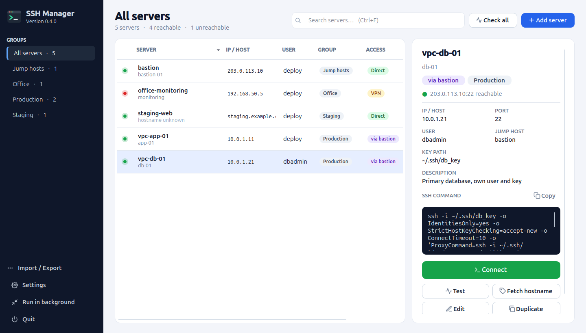

# SSH Manager

A desktop app for keeping an inventory of SSH servers and opening a session with one click,
so you don't have to remember IPs, hostnames, users, keys or jump hosts. Runs on Ubuntu, macOS and Windows.

**[⬇ Download the latest release](https://github.com/imtiaz9832/ssh-manager/releases/latest)**



- Table of servers: name, hostname, IP, user, group, access (Direct / VPN / via jump host), description
- Details panel: key path (warns if the file is missing), jump host, full `ssh` command
- Add, edit, duplicate and delete servers; group filter and instant search
- **Connect** (double-click / Enter) opens a new terminal tab running ssh
- **Test** / **Check all**: TCP check of port 22 on the first hop (hints "VPN connected?" for VPN servers)
- **Fetch hostname(s)**: logs in non-interactively and fills in each server's real hostname
- Import from `~/.ssh/config` or JSON, export to JSON
- Web-dashboard style UI: light / dark / system theme, adjustable font size (applies instantly), right-click menu, toasts
- Resizable panels: drag the borders between the sidebar, server list and details; the layout is remembered
- Can run in the background: **Run in background** hides the window; run `ssh-manager` again to bring it back

## Install

Download the package for your system from the
[latest release](https://github.com/imtiaz9832/ssh-manager/releases/latest). Each one is self-contained
(Python and Qt included); you only need an OpenSSH client, which ships with all three systems.

| System | Download | Install |
|---|---|---|
| Ubuntu / Debian (x86_64) | `ssh-manager_<version>_amd64.deb` | `sudo apt install ./ssh-manager_<version>_amd64.deb` |
| Other Linux (x86_64) | `ssh-manager-<version>-linux-x86_64.tar.gz` | Extract and run `ssh-manager/ssh-manager` |
| macOS 13+ (Apple Silicon) | `ssh-manager-<version>-macos-arm64.dmg` | Drag **SSH Manager** to Applications |
| Windows 10 / 11 (x64) | `ssh-manager-<version>-windows-x64-setup.exe` | Run the installer (no admin needed) |
| Windows, portable | `ssh-manager-<version>-windows-x64-portable.zip` | Extract and run `ssh-manager.exe` |

The apps aren't code-signed yet. On **macOS**, if it says the app is damaged or can't be opened, run
`xattr -dr com.apple.quarantine "/Applications/SSH Manager.app"` once. On **Windows**, if SmartScreen
appears, click **More info → Run anyway**.

When upgrading, click **Quit** in the running app first, so the new version starts fresh.

## Background mode

- `ssh-manager` started from a terminal detaches right away and gives you the prompt back.
- The close button (✕) quits the app. To keep it running, click **Run in background** in the sidebar, or turn on
  "Keep running in the background when the window is closed" in Settings. Run `ssh-manager` again, or open it
  from the app menu, to bring the same window back. Only one instance runs at a time.
- `ssh-manager --hidden` starts it without a window; `ssh-manager quit` stops it.
- On desktops with a system tray, a tray icon shows/hides the window and has a quick-connect menu.
  On Linux desktops (not WSL), Settings can start it in the background when you log in.
- `--foreground` keeps it attached to the terminal (useful for debugging); otherwise logs go to
  `~/.config/ssh-manager/ssh-manager.log`.

## Inventory

All servers live in one JSON file. Its location depends on the OS:

| OS | Inventory file |
|---|---|
| Linux / WSL | `~/.config/ssh-manager/inventory.json` |
| macOS | `~/Library/Application Support/ssh-manager/inventory.json` |
| Windows | `%APPDATA%\ssh-manager\inventory.json` |

Set `SSH_MANAGER_HOME` to use a different folder. The file is created on the first save, so it's fine
if it doesn't exist yet.

### Start from the sample

[`examples/inventory.example.json`](examples/inventory.example.json) shows every kind of entry: a jump host,
servers behind it, a server with its own user and key, a VPN-only server, and one with a custom port and
extra ssh options. Edit it with your servers, then use it in one of two ways.

Copy it into place. This replaces any existing inventory:

```bash
mkdir -p ~/.config/ssh-manager
cp examples/inventory.example.json ~/.config/ssh-manager/inventory.json
```

Or merge it into the inventory you already have. Servers whose `name` already exists are skipped, and
settings are only filled in where they're still empty:

```bash
ssh-manager import examples/inventory.example.json
```

A running app picks up changes to the file automatically. You can also add servers in the app with
**Add server**, or with **Import / Export → Import ~/.ssh/config**.

### Server fields

Only `name` and `host` are required.

| Field | Example | Meaning |
|---|---|---|
| `name` | `vpc-app-01` | Unique alias: letters, digits, `.`, `_`, `-`. Also used as `ssh <name>` |
| `host` | `10.0.1.11` | IP address or DNS name to connect to |
| `hostname` | `app-01` | The machine's own hostname, shown in the list. **Fetch hostname** fills it in |
| `user` | `dbadmin` | Login user. Empty = `default_user` |
| `port` | `2222` | SSH port. Default `22` |
| `key_path` | `~/.ssh/db_key` | Private key. Empty = `default_key` |
| `jump` | `bastion` | `name` of another server to use as the jump host (one hop) |
| `requires_vpn` | `true` | Shows a VPN badge and a "VPN connected?" hint when unreachable |
| `group` | `Production` | Groups in the sidebar |
| `description` | `Primary database` | Free text, searchable |
| `extra_options` | `["ServerAliveInterval=30"]` | Extra `ssh -o` options |

### Settings

| Setting | Default | Meaning |
|---|---|---|
| `default_user` | `""` | User for servers without one |
| `default_key` | `""` | Key for servers without one (empty = ssh's own defaults) |
| `terminal` | `"auto"` | Terminal to open sessions in (see [Terminal](#terminal)) |
| `theme` | `"system"` | `system`, `light` or `dark` |
| `font_size` | `11` | UI font size in points; the layout scales with it |
| `keep_running_on_close` | `false` | `true` = the close button hides the window instead of quitting |

### Use the servers outside the app

Every save also writes `~/.config/ssh-manager/ssh_config`. To use the same servers from any terminal
(`ssh vpc-app-01`, `scp`, VS Code Remote-SSH...), add this line at the **top** of `~/.ssh/config`:

```
Include ~/.config/ssh-manager/ssh_config
```

## Terminal

**Connect** opens a new terminal running `ssh-manager connect <name>`. Pick the terminal in
**Settings → Terminal**:

- `auto` (recommended): Windows Terminal on WSL, Terminal.app on macOS, Windows Terminal or cmd on Windows,
  and otherwise the first Linux terminal it finds (gnome-terminal, konsole, xfce4-terminal, kitty, xterm...).
- A template. The list only shows terminals installed on this machine, and you can type your own:
  `{args}` is replaced by the command as separate arguments, `{cmd}` by one quoted string, and `{title}` by the
  server name. Examples: `gnome-terminal -- {args}`, `xterm -T {title} -e {args}`.

If the terminal fails to start, the app shows **Terminal didn't open** with the terminal's own error output,
and a **Use auto and retry** button that switches back to `auto` and reconnects.

## Troubleshooting

- **Connect does nothing / "Terminal didn't open" on WSL:** set the terminal to `auto`. On WSL,
  `x-terminal-emulator` often points to a Linux terminal that can't start under WSLg (for example, zutty
  aborts with `No suitable files for '9x18' found!`).
- **Changes don't show up after upgrading:** an app started before the upgrade keeps running the old version.
  Click **Quit** in the sidebar (closing the window may only hide it), then start `ssh-manager` again.
- **"VPN connected?" on every server:** the first hop isn't reachable on port 22. Connect the VPN, then
  click **Check all**.
- **Logs:** `~/.config/ssh-manager/ssh-manager.log`, or run `ssh-manager --foreground` to see output in
  the terminal.

## CLI

```bash
ssh-manager show | quit           # show / stop the background instance
ssh-manager connect NAME          # ssh in the current terminal
ssh-manager list
ssh-manager command NAME          # print the full ssh command
ssh-manager fetch-hostnames [NAME...]   # log in and record hostnames (skips ones already known)
ssh-manager import FILE.json
ssh-manager import-ssh-config [~/.ssh/config]
```

On Windows the app is GUI-only, so these commands are for Linux and macOS.

## Development

```bash
python3 -m venv .venv && .venv/bin/pip install -e .
.venv/bin/python -m sshmgr --foreground
```

### Building packages

`packaging/build.py` builds the packages for the OS it runs on into `dist/release/`: a `.deb` and `.tar.gz`
on Linux, a `.dmg` on macOS, and a setup `.exe` (needs [Inno Setup](https://jrsoftware.org/isinfo.php)) plus a
portable `.zip` on Windows.

```bash
pip install -e . pyinstaller
python packaging/build.py          # or packaging/build.sh on Linux/macOS (uses .venv)
```

### Releasing

Pushing a version tag runs [`.github/workflows/release.yml`](.github/workflows/release.yml). It builds on
Ubuntu, macOS and Windows, smoke-tests each build, and publishes a GitHub release with every package,
`SHA256SUMS.txt`, and the notes from `docs/releases/<tag>.md`:

```bash
# bump __version__ in sshmgr/__init__.py and pyproject.toml, add docs/releases/vX.Y.Z.md, commit, then:
git tag -a vX.Y.Z -m "vX.Y.Z" && git push origin vX.Y.Z
```
