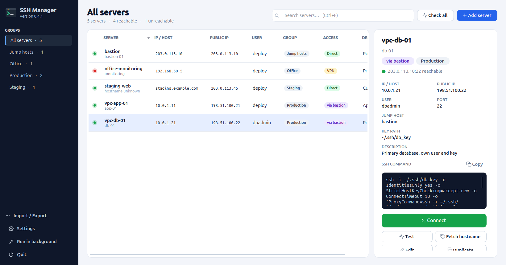

# Hostrix v0.5.1

**Your entire server fleet, connected.** SSH Manager is now **Hostrix**, and it's open source under the
Apache License 2.0. Download a ready-to-run package for your system below; there's nothing to build.



## Download

| System | File | How to install |
|---|---|---|
| **macOS** 13+ (Apple Silicon) | `hostrix-macos-arm64.dmg` | Open it and drag **Hostrix** to **Applications** |
| **Windows** 10 / 11 (x64) | `hostrix-windows-x64-setup.exe` | Run the installer. No admin rights needed |
| **Windows**, portable | `hostrix-windows-x64-portable.zip` | Extract anywhere and run `hostrix.exe` |
| **Ubuntu / Debian** (x86_64) | `hostrix-linux-amd64.deb` | `sudo apt install ./hostrix-linux-amd64.deb` |
| **Other Linux** (x86_64) | `hostrix-linux-x86_64.tar.gz` | Extract and run `hostrix-<version>/hostrix/hostrix` |

Each file is also listed with the version in its name. `SHA256SUMS.txt` has checksums for all of them.

### First launch on macOS and Windows

The apps aren't code-signed yet, so the OS warns you the first time:

- **macOS:** if it says the app "can't be opened" or "is damaged", run this once, then open it again:
  ```bash
  xattr -dr com.apple.quarantine "/Applications/Hostrix.app"
  ```
- **Windows:** if SmartScreen shows "Windows protected your PC", click **More info → Run anyway**.

## What's new

- **v0.5.1 fixes the macOS build**, which failed in v0.5.0. This is the first Hostrix release with downloads.
- **New name: Hostrix.** The app, the `hostrix` command, the packages and the repository
  ([github.com/Muhammad-Imtiaz/hostrix](https://github.com/Muhammad-Imtiaz/hostrix)) all carry the new name.
- **Your servers come with you.** On first start, Hostrix copies your servers and settings from the old
  `ssh-manager` folder and leaves the old folder untouched. Start-on-login moves over too.
- **Open source** under the [Apache License 2.0](https://github.com/Muhammad-Imtiaz/hostrix/blob/v0.5.1/LICENSE):
  free for personal and commercial use.
- **About** in the sidebar shows the version, the author and the license, with links to star the project or
  report an issue.
- **Direct download links:** the README's download buttons always fetch the newest build for your system.
- The Windows installer shows the license, and every package includes the copyright and NOTICE.
- New contributing guide, security policy, issue templates and changelog.

### Coming from SSH Manager?

- **Ubuntu / Debian:** installing the Hostrix `.deb` replaces the `ssh-manager` package.
- **`~/.ssh/config`:** if it has `Include ~/.config/ssh-manager/ssh_config`, change it to
  `Include ~/.config/hostrix/ssh_config`.
- `SSH_MANAGER_HOME` still works; the new name for it is `HOSTRIX_HOME`.

## Compatibility

| | Supported |
|---|---|
| Ubuntu | 22.04, 24.04 and newer; also Debian 12+ |
| WSL2 | Windows 10 / 11 with WSLg |
| macOS | 13 Ventura or newer, Apple Silicon |
| Windows | 10 (1809+) and 11, x64, with the built-in OpenSSH client |

## Feedback

Tried it? Tell me what works, what's missing, and what broke:
[open an issue](https://github.com/Muhammad-Imtiaz/hostrix/issues/new/choose). If it saves you time, a ⭐ helps
others find it.

Created by [Muhammad Imtiaz](https://github.com/Muhammad-Imtiaz).
